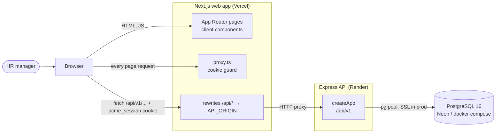
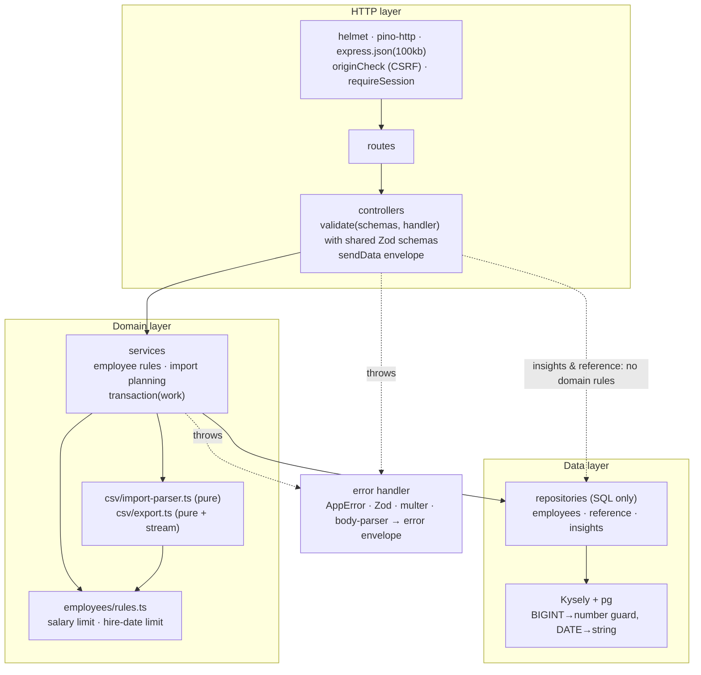
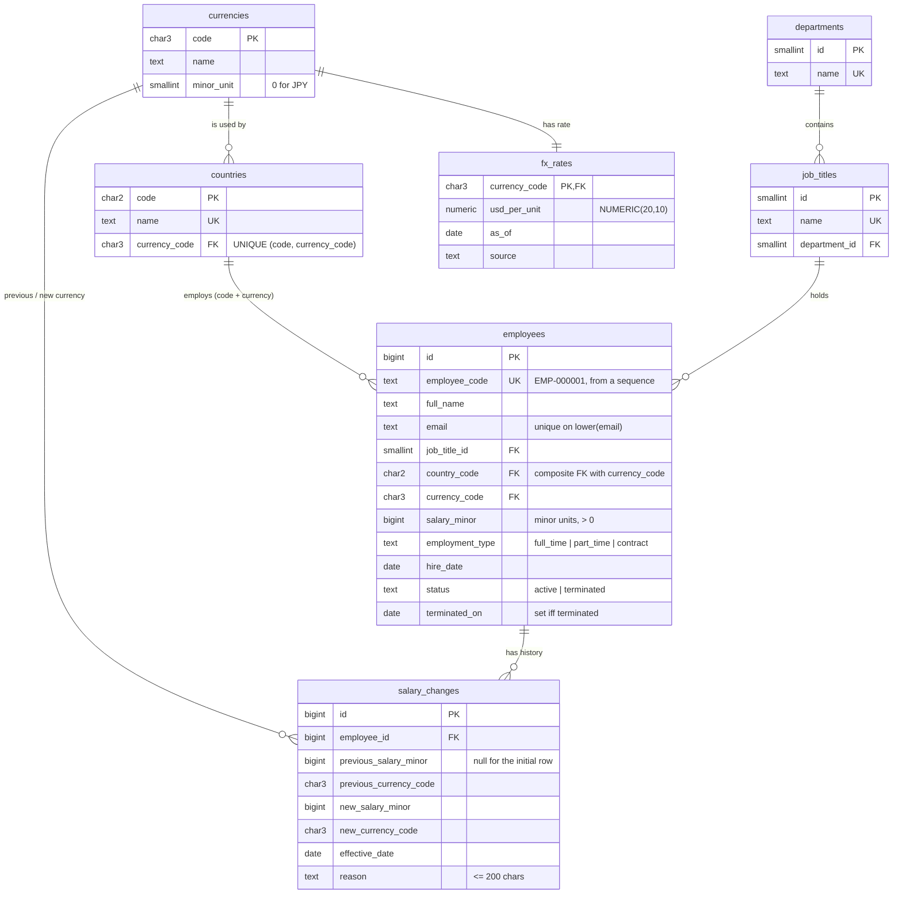
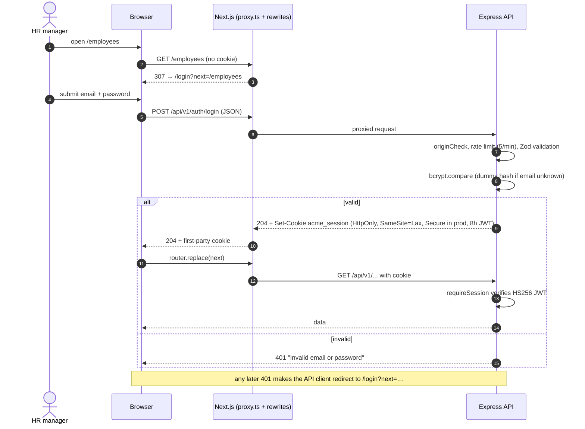

# Architecture

ACME Salary Management is a TypeScript monorepo: an Express 5 + PostgreSQL API, a Next.js App Router
web app, and a shared package that holds the API contract. Product scope is in
[REQUIREMENTS.md](REQUIREMENTS.md), the technical specification in [SPEC.md](SPEC.md), and the
reasoning behind each major choice in [adr/](adr/).

```
packages/shared   Zod schemas, DTO types, enums, money utilities (imported as TS source by both apps)
apps/api          Express 5, Kysely + pg, pino, jose, bcryptjs, multer, csv-parse / csv-stringify
apps/web          Next.js 16 (App Router), React 19, Tailwind + shadcn/ui, TanStack Query/Table, nuqs, Recharts
```

## System context

The browser only ever talks to the Next.js origin. Next.js rewrites `/api/*` to the API, so the
session cookie is first-party and no CORS is needed ([ADR 0008](adr/0008-single-user-jwt-cookie-same-origin-proxy.md)).



## API layering

Every module follows routes → controller → service → repository. Dependencies are passed in through
factory functions; `createApp(deps)` only wires them, so tests build the same app with fakes.



| Module      | Routes                                                                                         | Notes                                                     |
| ----------- | ---------------------------------------------------------------------------------------------- | --------------------------------------------------------- |
| `health`    | `GET /health`                                                                                  | public; checks the database                               |
| `auth`      | `POST /auth/login`, `POST /auth/logout`, `GET /auth/me`                                        | login rate-limited 5/min                                  |
| `reference` | `GET /reference`                                                                               | countries with currency exponent, departments, titles, FX |
| `employees` | `GET/POST /employees`, `GET/PATCH /employees/:id`, `POST /employees/:id/terminate`             | service enforces SPEC §2                                  |
| `csv`       | `GET /employees/export.csv`, `POST /employees/import`                                          | registered before `/employees/:id`                        |
| `insights`  | `/insights/summary`, `/by-country`, `/by-country/:code`, `/by-job-title/:id`, `/by-department` | one SQL statement each                                    |

## Data model

Reference tables are filled by a migration, so every environment has them. Employee currency is
pinned to the country by a composite foreign key ([ADR 0004](adr/0004-currency-derived-from-country.md));
salary history is append-only ([ADR 0006](adr/0006-append-only-salary-history.md)).



## Login sequence



## CSV import sequence

```mermaid
sequenceDiagram
  autonumber
  actor HR as HR manager
  participant W as Import page
  participant A as API (csv routes)
  participant P as import-parser (pure)
  participant S as import-service
  participant DB as PostgreSQL
  HR->>W: choose employees.csv
  W->>A: POST /employees/import?dryRun=true (multipart, ≤ 5 MB)
  A->>P: parseImportFile(text)
  alt missing headers / not CSV / > 10,000 rows
    P-->>W: 400 VALIDATION_ERROR (file-level)
  end
  A->>S: run(text, dryRun)
  S->>P: validateImportRows(rows, reference data)
  S->>DB: findByCodes, findByEmails
  S->>S: plan create / update / unchanged + DB-level row errors
  S-->>W: 200 { toCreate, toUpdate, unchanged, errors[] }
  W->>HR: summary + error table; Apply enabled only with 0 errors
  HR->>W: Apply import
  W->>A: POST /employees/import?dryRun=false
  A->>S: run again (re-validates the same file)
  S->>DB: BEGIN
  S->>DB: insert / update employees, insert salary_changes ("CSV import")
  S->>DB: COMMIT (or ROLLBACK on any failure)
  S-->>W: 200 result
  W->>W: invalidate employee and insights queries, toast
```

## Web app structure

```
apps/web/src/
  proxy.ts                         cookie guard → /login (Next 16 name for middleware)
  app/(auth)/login                 sign-in
  app/(app)/layout.tsx             sidebar + header (AppShell)
  app/(app)/employees              list, new, [id] (detail + edit + history + terminate)
  app/(app)/insights, import
  features/<feature>/              api/hooks, components, tests
  lib/api-client.ts                typed fetch: envelope parsing, response schemas, 401 → /login
  lib/money.ts                     formatting via the shared money utilities
```

Server state lives in TanStack Query; list filters, sort, page and insight drill-downs live in the
URL (nuqs) so views can be shared. Forms use react-hook-form with the shared Zod rules.

## Cross-cutting concerns

- **Money:** integer minor units, exponent from `currencies`, exact string/BigInt conversion
  ([ADR 0003](adr/0003-money-as-integer-minor-units.md)).
- **USD:** static dated FX ([ADR 0005](adr/0005-static-dated-fx-table.md)); every USD response carries
  `meta.fx` and every USD figure in the UI is shown with `≈` and the as-of date.
- **Errors:** one envelope `{ error: { code, message, details? } }`; field-level errors use Zod's
  `{ formErrors, fieldErrors }` shape so forms map them to inputs.
- **Logging:** pino with redaction of passwords, cookies and authorization headers.
- **Time:** an injected `clock` provides "today" to services, so tests are deterministic.
