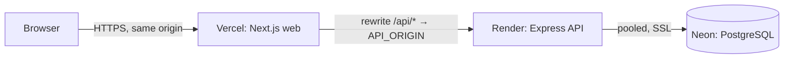

# Deployment

Production runs on three free-tier services:



The browser only ever talks to the Vercel origin. Next.js rewrites `/api/*` to the Render API, so the
session cookie is first-party and no CORS configuration is needed (ADR 0008).

Do the steps in this order: database → API → web → seed.

## 1. Neon (PostgreSQL)

1. Create a Neon project (PostgreSQL 16 or newer) and a database, e.g. `acme_salary`.
2. Copy the **pooled** connection string (host contains `-pooler`) and make sure it ends with
   `?sslmode=require`. This is `DATABASE_URL` for Render and for seeding.
3. Nothing else: migrations, including the reference data (countries, currencies, FX rates,
   departments, job titles), run automatically when the API starts.

## 2. Render (API)

The repository contains a Blueprint, [`render.yaml`](../render.yaml).

1. In Render choose **New → Blueprint**, connect the GitHub repository and select `render.yaml`.
2. Fill in the variables marked `sync: false`:

   | Variable           | Value                                                                                      |
   | ------------------ | ------------------------------------------------------------------------------------------ |
   | `DATABASE_URL`     | Neon pooled URL from step 1 (`?sslmode=require`)                                           |
   | `HR_EMAIL`         | the HR login, e.g. `hr@acme.test`                                                          |
   | `HR_PASSWORD_HASH` | output of `pnpm --filter api hash-password '<password>'` (bcrypt, cost 12)                 |
   | `ALLOWED_ORIGINS`  | the Vercel URL from step 3, e.g. `https://acme-salary.vercel.app` (comma-separate several) |

   `SESSION_SECRET` is generated by Render; `NODE_ENV=production`, `NODE_VERSION`, `LOG_LEVEL` and `COREPACK_ENABLE_DOWNLOAD_PROMPT=0` are set
   by the Blueprint. `PORT` is provided by Render.

3. Deploy. The Blueprint uses:
   - build: `corepack pnpm install --frozen-lockfile --prod=false && corepack pnpm --filter api build`
   - start: `cd apps/api && npm run start` (runs `node dist/migrate.js`, then `node dist/server.js`)

   pnpm is invoked as `corepack pnpm`, which uses the version pinned in the root `package.json`
   (`packageManager`). Do not add `corepack enable` to the build: it tries to write shims into
   `/usr/bin`, which is read-only on Render, and the build fails with
   `EROFS: read-only file system, unlink '/usr/bin/pnpm'`.
   - health check: `/api/v1/health`

4. Check `https://<service>.onrender.com/api/v1/health` returns
   `{"data":{"status":"ok","db":"ok"}}`.

If `ALLOWED_ORIGINS` is not known yet, deploy the web app first with a placeholder, then update the
variable; the API fails fast at boot if any required variable is missing or invalid.

## 3. Vercel (web)

1. **New Project** → import the repository.
2. **Root Directory:** `apps/web`. Vercel detects Next.js and pnpm from the lockfile at the repo root
   (keep "Include files outside the root directory" enabled, the web app imports `packages/shared`).
3. Environment variable **`API_ORIGIN`** = the Render URL, e.g. `https://acme-salary-api.onrender.com`
   (no trailing slash). The build fails on Vercel if it is missing.
4. Deploy, then set Render's `ALLOWED_ORIGINS` to the final Vercel URL (step 2) if it changed.

## 4. Seed the demo data once

Seeding replaces all employee data, so it refuses to run in production unless confirmed. Run it from
your machine against Neon:

```bash
# bash / Git Bash
DATABASE_URL='postgres://…-pooler…/acme_salary?sslmode=require' NODE_ENV=production SEED_CONFIRM=yes pnpm db:seed
```

```powershell
# PowerShell
$env:DATABASE_URL = 'postgres://…-pooler…/acme_salary?sslmode=require'
$env:NODE_ENV = 'production'; $env:SEED_CONFIRM = 'yes'
pnpm db:seed
Remove-Item Env:DATABASE_URL, Env:NODE_ENV, Env:SEED_CONFIRM
```

Real environment variables take precedence over `apps/api/.env.example`, so this targets Neon. Run
`pnpm db:migrate` the same way first if the API has not started yet. Expect 10,000 employees in
roughly 10–30 s over the network.

## 5. Smoke test

1. Open the Vercel URL → you are redirected to `/login`.
2. Sign in with the HR credentials → the employee list shows 10,000 records.
3. Open Insights; export a CSV and re-import it as a dry run → all rows unchanged.

## Notes for reviewers

- **Cold starts.** Render's free plan sleeps after ~15 minutes without traffic; the first request
  can take 30–60 s while the API wakes (Neon's free compute also auto-suspends and resumes in about a
  second). If the login page shows an error, wait a moment and retry.
- **Rate limiting behind two proxies.** Requests reach Render through Vercel, so the API sees
  Vercel's egress address as the client IP (`trust proxy` is one hop). The 5-per-minute login limit
  therefore applies to all users together, which is acceptable for the single HR account (see
  docs/TRADEOFFS.md).
- **Secrets** live only in the Render and Vercel dashboards. Rotate the HR password by generating a
  new hash and updating `HR_PASSWORD_HASH`; rotate `SESSION_SECRET` to sign everyone out.
